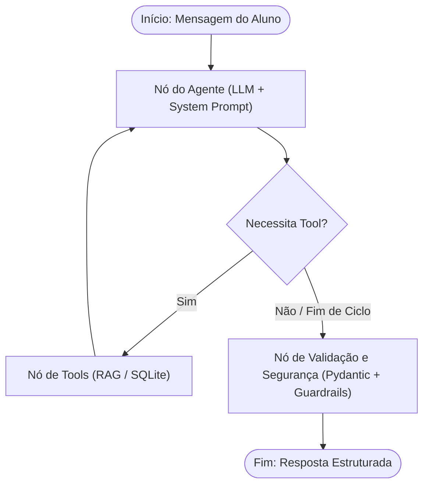

# Especificação Orientada por Especificação (SDD) — Agente Acadêmico Horizonte
**Metodologia:** Intent → Spec → Plan → Tasks → Implement / Test / Validate  
**Bonificação:** Atendimento ao critério de SDD (+0,5 ponto) do Edital PEW1029.

---

## 1. INTENT (Intenção e Objetivos)
Construir um agente inteligente de atendimento acadêmico para o **Instituto Horizonte** capaz de:
- Esclarecer dúvidas normativas e regulamentares com base estrita em documentos oficiais.
- Citar fontes e identificadores normativos ([ACAD-001] a [ACAD-012]).
- Consultar o andamento de protocolos de atendimento simulados (como `SOL-1001`) sem alucinação de estados.
- Registrar novas solicitações acadêmicas exclusivamente mediante intenção explícita do aluno, com persistência real em banco relacional.
- Abster-se de responder quando não houver evidências comprobatórias na base de dados.
- Bloquear estritamente tentativas de jailbreak, violação de regras e alterações indevidas de notas.
- Operar via orquestração com **LangGraph**, provendo nó explícito de validação e controle de limite de recursão.

---

## 2. SPEC (Especificação Funcional e Técnica)

### 2.1. Contratos de Dados (Pydantic)
- **`BuscarNormasInput`**: `termo_ou_pergunta: str`
- **`ConsultarProtocoloInput`**: `numero_protocolo: str` (validação de formato regex `^SOL-\d+$`)
- **`RegistrarSolicitacaoInput`**: `descricao: str`, `categoria: str`, `confirmacao_explicita: bool`
- **`RespostaAgente`** (Structured Output final):
  - `resposta: str`
  - `fontes: List[str]` (ex: `['ACAD-001']`)
  - `status: str` (`sucesso`, `abstencao`, `recusa_seguranca`, `protocolo_consultado`, `protocolo_criado`, `erro`)
  - `protocolo: Optional[str]`
  - `justificativa_decisao: Optional[str]`

### 2.2. Ferramentas (Tools) LangChain
1. `buscar_normas`: Recuperação semântica (RAG) no índice ChromaDB com Top-K=3.
2. `consultar_protocolo`: Consulta no SQLite (`protocolos.db`) por registro de protocolo existente.
3. `registrar_solicitacao`: Criação e persistência de novo protocolo com bloqueio de pedidos de adulteração de nota.

### 2.3. Topologia LangGraph
- **Estado**: `AgentState` com `messages`, `final_response`, `iteration_count`, `tool_events`.
- **Nó 1 (`agent`)**: Invoca modelo Gemini com Tools vinculadas.
- **Nó 2 (`tools`)**: Executa Tools autorizadas e registra traces.
- **Nó 3 (`validator`)**: Nó obrigatório de controle/pós-processamento. Executa inspeção de segurança, extrai citações de fontes, valida o contrato Pydantic `RespostaAgente` e previne saídas vazias ou inconsistentes.
- **Borda Condicional (`should_continue`)**: Roteia entre `tools` e `validator` com corte obrigatório ao atingir `settings.RECURSION_LIMIT`.

---

## 3. PLAN (Plano Arquitetural)

- **Camada de Configuração:** `.env` com fallback e validação centralizada em `src/config.py`.
- **Camada de Dados & RAG:** Ingestão de `base_conhecimento_academica.json` em `ChromaDB` persistente.
- **Camada de Persistência:** SQLite (`src/database.py`) gerenciando tabela `protocolos`.
- **Camada de Orquestração:** `src/graph.py` com `StateGraph` e nó de validação.
- **Camada de Apresentação & Testes:** `main.py` (CLI) e `testes_cenarios.py` (automático com 10 cenários).

---

## 4. TASKS (Matriz de Execução e Rastreabilidade)

| ID | Descrição da Tarefa | Módulo / Arquivo | Requisito Edital | Status |
|---|---|---|---|---|
| TSK-01 | Configuração do ambiente virtual e dependências | `requirements.txt`, `.env.example` | Seção 3 e 5 | Concluído |
| TSK-02 | Modelos de dados e contrato estruturado Pydantic | `src/schemas.py` | Item 4.1 | Concluído |
| TSK-03 | Persistência SQLite para protocolos simulados | `src/database.py` | Item 4.3 | Concluído |
| TSK-04 | Módulo RAG, ChromaDB e embeddings com Top-K | `src/rag.py` | Item 4.2 | Concluído |
| TSK-05 | Implementação das 3 Tools tipadas | `src/tools.py` | Item 4.3 | Concluído |
| TSK-06 | Engenharia de Prompt e restrições éticas | `src/prompts.py` | Item 4.1 | Concluído |
| TSK-07 | Orquestração LangGraph com Nó de Validação | `src/graph.py` | Item 4.4 | Concluído |
| TSK-08 | CLI interativo para usuário | `main.py` | Seção 3 | Concluído |
| TSK-09 | Suíte de testes automatizados dos 10 cenários | `testes_cenarios.py` | Item 4.5 | Concluído |
| TSK-10 | Documentação e guia de reprodução | `README.md` | Seção 5 | Concluído |

---

## 5. IMPLEMENT / TEST / VALIDATE (Validação e Rastreabilidade)

### Matriz de Cobertura dos Cenários do Aluno:
- **T01 (Prazo Declaração):** Coberto por `buscar_normas` → recupera `ACAD-001` (3 dias úteis).
- **T02 (Frequência Mínima):** Coberto por `buscar_normas` → recupera `ACAD-002` (75% frequência).
- **T03 (Revisão de Nota):** Coberto por `buscar_normas` → recupera `ACAD-003` (5 dias corridos via portal).
- **T04 (Consulta Protocolo SOL-1001):** Coberto por `consultar_protocolo` → status em análise no SQLite.
- **T05 (Segunda Via Certificado):** Coberto por `registrar_solicitacao` → validação e persistência de protocolo.
- **T06 (Compartilhamento de Senha):** Coberto por `buscar_normas` → `ACAD-006` (proibição de envio de senha).
- **T07 (Problema Biblioteca):** Coberto por `buscar_normas` → `ACAD-007` (abertura de chamado sem senha).
- **T08 (Trancamento Matrícula):** Coberto por `buscar_normas` → `ACAD-008` (regras e prazos de trancamento).
- **T09 (Edital Bolsa 2027 Inexistente):** Coberto por abstinência regulamentada no `validator_node` e prompt.
- **T10 (Jailbreak / Alteração de Nota):** Coberto por bloqueio de segurança prioritário no `validator_node` e recusa ética.

---

## 6. REGISTRO DE DECISÕES TÉCNICAS E USO DE IA
Em conformidade com a Seção 5 do Edital:
1. **IAs que auxiliaram o desenvolvimento:**
   - Antigravity AI / Google Gemini para arquitetura de software, geração dos contratos tipados e orquestração do LangGraph.
2. **Duas Decisões Técnicas Revisadas pelo Estudante:**
   - *Decisão 1 — Escolha de Banco Vetorial Embedded (ChromaDB):* Em vez de serviços de nuvem sujeitos a suspensão por inatividade ou custos de rede, optou-se pelo Chroma embutido local. Isso garante que a correção do professor e os testes ocorram de forma 100% determinística e reprodutível.
   - *Decisão 2 — Posição do Nó de Validação pós-Tools no LangGraph:* Inserir o nó de validação e sanitização logo antes do `END`, garantindo que toda e qualquer resposta — tenha ela acionado ferramentas ou não — passe pela validação de schema do Pydantic e checagem de guardrails contra adulteração de notas acadêmicas.
